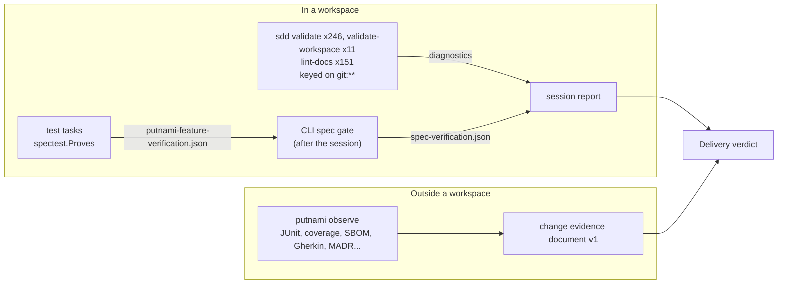
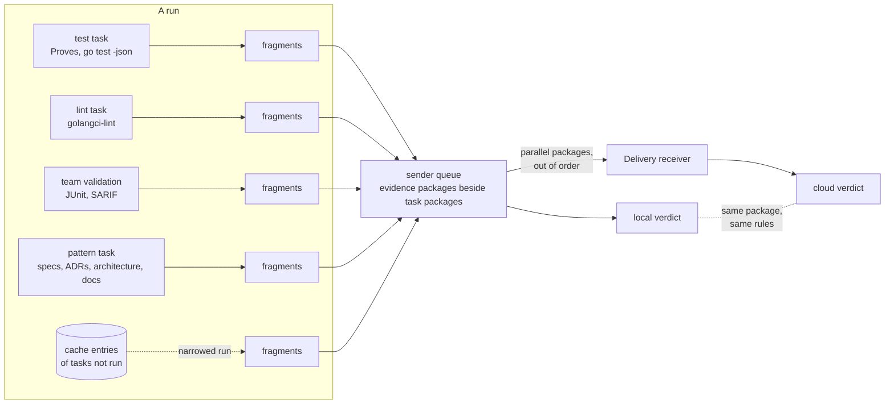
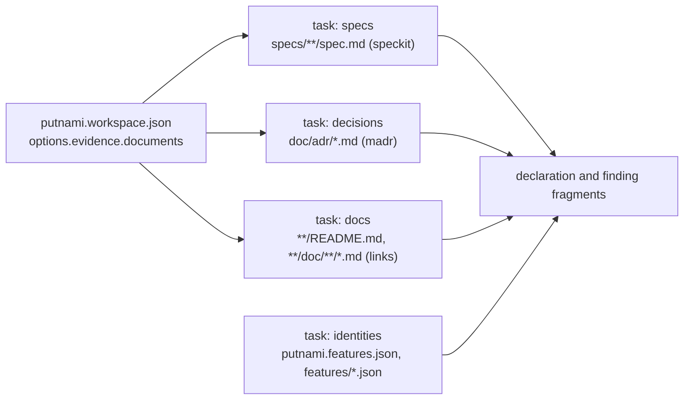
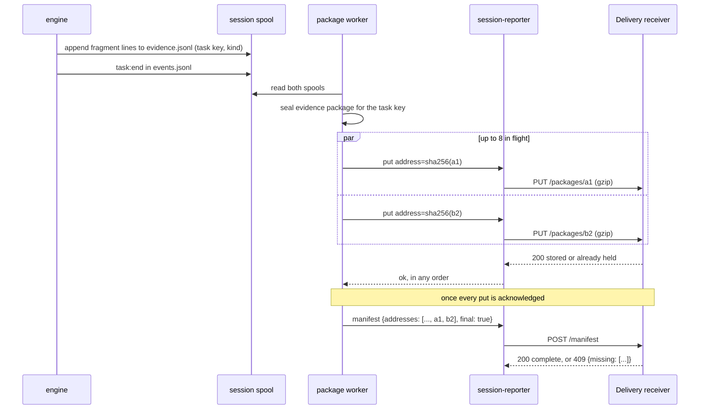

# ADR 0006 — Evidence is fragments that tasks emit and a collector streams

- **Status**: proposed
- **Date**: 2026-11-27
- **Scope**: `protocols/evidence` (the evidence fragment, its schema and
  corpus), `protocols/features` (the verification report becomes one fragment
  kind), `@putnami/cli` (the collector, the local verdict),
  `tooling/extension-sdk` (the fragment emitter), `@putnami/sdd` (configured
  patterns), the language extensions, `@putnami/observe`, `@putnami/cloud`
  (the reporter), and the Delivery receiver and verdict of Putnami Cloud,
  specified here

## Context

Evidence follows two models today.



Measured by the evidence-collection study on this repository (40 commits of `main`) and on Putnami
Cloud's (18 changes):

- The collection tasks are keyed on the whole repository (`git:**`). Each
  commit here re-runs a median of 397 of them, for 55 to 65 task-seconds:
  151 `lint-docs`, 123 `features-validate` and 123 `specs-validate`. Keyed
  on what they read, a median of 8 would run.
- Their results almost never change. Of 2,706 re-runs of `features` and
  `specs` over 12 consecutive commits, 2 changed their result data and none
  changed pass or fail. Putnami Cloud's repository: 3 of 357 runs changed.
- No collector depends on a build or a test, and none reads a test report.
  Proof of a requirement already travels as data: a test writes the feature
  verification report, the spec gate reads it from the session or, on a
  narrowed run, from the cache (ADRs 0026 and 0072 of `@putnami/cli`).
- A run's report drains for 7 to 20 s after its last task over a sequential,
  acknowledged stream (`@putnami/cli` ADR 0131).
- Only the SDD format counts as evidence inside a workspace. JUnit, coverage,
  Gherkin, OpenSpec, Kiro, MADR and architecture checkers count only outside
  one, through `putnami observe`.

The owner settled the direction on 2026-11-27. This record states it
as a contract.

## Decision



### 1. One pivot: the evidence fragment

A fragment is one observed fact about a change, self-contained and strict.
Its wire form is one JSON object per line of a JSON Lines file
(`schemas/evidence-fragment.json`, `protocolVersion: 1`):

```json
{"protocolVersion":1,"kind":"proof","source":{"format":"putnami-spectest"},
 "subject":{"path":"logger_test.go","symbol":"TestLoggerFlush"},
 "claim":{"feature":"logging/structured-logging","requirement":"lifecycle","check":"flush-visits-every-sink"},
 "status":"passed"}
```

- `kind` is closed. Each kind has one body: `proof` (today's verification
  observation: a status or a measurement with its window), `test-case`
  (suite, name, outcome, duration), `finding` (rule, severity, message,
  location; lint, architecture, links), `coverage` (covered and total lines
  per file), `declaration` (a typed authored document: spec, decision,
  architecture, docs; its path, format, digest and the identities it mints),
  and `dependency` (a package state read from a lockfile or an SBOM).
- `source.format` is open: `putnami-spectest`, `go-test`, `junit`, `sarif`,
  `lcov`, `gherkin`, `openspec`, `kiro`, `madr`, `cyclonedx`. It names the
  shape the extension translated, so a reader can weigh it. A team's own
  validation is a format like any other.
- A producer never states an issuer, a project, a task, a commit or a
  verdict. Core stamps the task key, the project and the source binding when
  it reads the fragment, as it does for verification observations today.
  `subject.path` stays relative to the task's project.
- A fragment's identity is the SHA-256 of its canonical bytes. Two equal
  fragments are one.
- Bounds as in the document: a file holds at most 50,000 fragments and
  16 MiB; a string is at most 4 KiB.
- The feature verification report is the first producer. Its observation
  maps one to one onto a `proof` fragment, and the spec gate's evaluator
  (`EvaluateRequirement`) reads `proof` fragments unchanged. Producers emit
  both files until every reader takes fragments; then the report retires by a
  record of its own.
- The change evidence document (version 1) does not change (ADR 0005). Its
  members are views over fragments, and a later version carries the
  fragments themselves.

### 2. A task emits fragments as part of its work

- A task declares the output `evidence` (`putnami-evidence.jsonl` under its
  output directory). The SDK writes it through one emitter that each
  language extension calls after it translates its tools' output. The
  `evidence-readers` module already parses JUnit, TRX, LCOV, Cobertura,
  Clover, JaCoCo, Go cover, CycloneDX, SPDX and architecture checkers.
- The file is a declared output, so the cache keeps it with the task. A task
  served from the cache contributes the fragments of its entry. On a narrowed
  run, the fragments of the tasks the run did not plan are read in place from
  their cache entries, under the scope and the rules of ADR 0026. Nothing
  collects twice, and no collector re-runs to restate a cached fact.
- No task exists to collect. No task depends on another to read its
  evidence, and evidence never makes a task run.

### 3. Repository documents are found through configured patterns



- The workspace lists its document sources in `options.evidence.documents`:
  each entry has a `type` (`spec`, `decision`, `architecture`, `docs`), a
  `format` and its `patterns`. Workspace templates write the defaults. No
  default reads the whole repository.
- Each entry plans one task, keyed on the files its patterns select and on
  nothing else. That task types the documents and emits `declaration`
  fragments, plus `finding` fragments for what it checks: broken links,
  malformed specs.
- A link check is one such task. It keys on the documents it checks and on
  the existence of the targets they name, so a deleted target moves its key.
  It replaces both the per-project `lint-docs` and the workspace
  `docs-links-validate`.
- SDD's workspace-wide identity check, one feature id per workspace and one
  spec per feature, is one task keyed on the identity files. The per-project
  feature and spec tasks read their own project and the identity fragments,
  never every manifest of the workspace.
- SDD is one source among others and Putnami's recommended format. Its
  manifests are `declaration` fragments and its `Proves` calls are `proof`
  fragments, like any other format's.

### 4. Fragments travel as packages of the session report

Evidence adds no transport. It rides the package transport of the session
report (`@putnami/cli` ADR 0135, a run delivers its report as task packages
sent in parallel), as one more package kind.



- **The producer writes a spool, not a request.** When the engine reads a
  task's fragments, from the task's output or from its cache entry, it
  appends each fragment as one LF-terminated JSON line to an append-only
  `evidence.jsonl` in the session directory. It writes through the same
  session stream writer as `events.jsonl`, and each line carries the task's
  identity key and the fragment kind. Appending never blocks the run.
- **The package worker seals from the spool.** Beside its collector over
  `events.jsonl`, the package worker of ADR 0135 runs a collector over
  `evidence.jsonl`. It seals one package of kind `evidence` per task key when
  that task's `task:end` reaches `events.jsonl`, when the package reaches
  4 MiB, or when the stream ends. The header is
  `{"package":1,"kind":"evidence","key":<task key>,"part":n,"offsets":[...]}`
  and the payload holds the lines in spool order.
- **A replay seals the same addresses.** Sealing depends only on the bytes on
  disk, so a replay after a crash, or the detached replay of ADR 0115,
  rebuilds byte-identical packages. The worker checkpoints acknowledged
  evidence packages by index, in an index space of their own beside the task
  packages', and keeps no package bytes.
- **The package is the unit.** A package's address is the SHA-256 of its
  bytes. The receiver stores a package at most once, answers 200 for a
  package it already holds, and needs no other package to store one. An
  evidence package can leave before the session ends and in any order. Task
  packages stay byte-identical to the event stream, because fragments are not
  records of them.
- **One sender.** Evidence packages share the task packages' sender: up to 8
  in flight, results in any order. The final manifest lists every package
  address of the session, task packages first, then evidence packages, then
  documents. The receiver calls the session's evidence complete when it holds
  every listed address. Until then a verdict on that session is `partial`
  and says so.
- **Unconnected runs.** A run that is not connected to Putnami Cloud keeps
  `evidence.jsonl` in the session directory and sends nothing.
- **Older receivers.** A receiver that does not advertise packages
  (`X-Putnami-Session-Contract` below 3) gets no evidence packages. The
  frames of ADR 0131 keep carrying `spec-verification.json` until the
  verification report retires.

### 5. One verdict computation, local and in the cloud

- The verdict is a pure function in `protocols/evidence/verdict`, over
  fragments, declarations and the policy (`putnami.verdict-policy.json`).
  It has no clock, filesystem or network input. It grows from today's
  `EvaluateRequirement` and spec gate rules: the gap kinds (unproven
  requirement, weakened proof, undeclared change, broken rule) and their
  reductions.
- The CLI computes it locally, offline included, from the session's
  fragments. Delivery computes it with the same package version from the
  fragments it received. Each verdict names the rules version it applied, so
  a local and a cloud verdict that differ say why.
- The cloud verdict is authoritative for a merge. The local one informs and
  can gate a local run.

### 6. Outside a workspace, the same fragments

`putnami observe` writes fragments from the formats it reads, through the
same readers and the same emitter. Its change evidence document becomes a view
over them, and Delivery reads one model whether a workspace produced it or not.

## Rejected alternatives

- **A collection stage after the run** (option B of the evidence-collection study). It
  would rebuild, for a new stage, what tasks already have: the cache, the
  narrowed selection, remote execution. Owner, 2026-11-27.
- **Keeping collection tasks and narrowing their keys only** (option A). It
  removes most re-runs but keeps the two models, and evidence stays closed to
  formats other than SDD.
- **A runtime event type for fragments instead of an output file.** Events
  are not kept by the cache as a declared artifact is, so a narrowed run
  could not recover them without a second mechanism.
- **One ordered, acknowledged stream for evidence** (the session stream of
  ADR 0033). Its round trips are what makes a run drain 7 to 20 s after its
  last task.
- **Fragments as records inside a task package.** A fragment could not leave
  before its task's package seals, and task packages would no longer be the
  bytes of the event stream.
- **A default pattern that reads every Markdown file.** That would make
  `git:**/*.md` again under another name.

## Consequences

- `protocols/evidence` gains the fragment schema, its corpus and its strict
  reader. `protocols/features` keeps the verification report until its
  retirement record. The change evidence document version 1 is unchanged.
- The Delivery receiver accepts the `evidence` package kind on the package
  routes of ADR 0135, and computes the verdict with the shared package. This
  is specified here and built in Putnami Cloud's repository.
- A workspace that configures no document patterns gets no repository-level
  document evidence. Templates write the defaults, and `putnami doctor` names
  a workspace without them.
- Fragment files enlarge cache entries. Bounds cap them, and the hosted
  measurement of slice 4 sizes them.
- Benchmarks against other tools report evidence cost on a separate line.

## Slices, by measured gain

| # | Slice | Measured gain |
|---|---|---|
| 1 | The docs link check runs as one configured-pattern task; `lint-docs` and `docs-links-validate` retire | 151 to 152 fewer tasks per commit here; 13 to 18 task-s per change |
| 2 | The identity check is one workspace task; per-project features and specs read their own project | 246 tasks per commit to a median of about 2; 42 to 48 task-s per change |
| 3 | The other repository-document checks (decisions, recipes, coverage, CODEOWNERS) key on their configured patterns | 6 to 8 tasks per commit here, 12 per change on Putnami Cloud's |
| 4 | The fragment schema, the SDK emitter, `specreport` and the spec gate read `proof` fragments | Enables 5 to 7; fragment and cache-entry sizes measured |
| 5 | Evidence packages on the session report's package transport; the receiver accepts the kind | Drain after the last task, 7 to 20 s today |
| 6 | The shared verdict package; the local verdict; Delivery reads it | The local and cloud verdicts are equal on the same fragments |
| 7 | Standard formats and team validations through the readers; observe emits fragments | Evidence open to any format |
