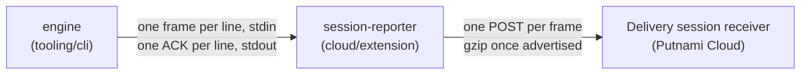
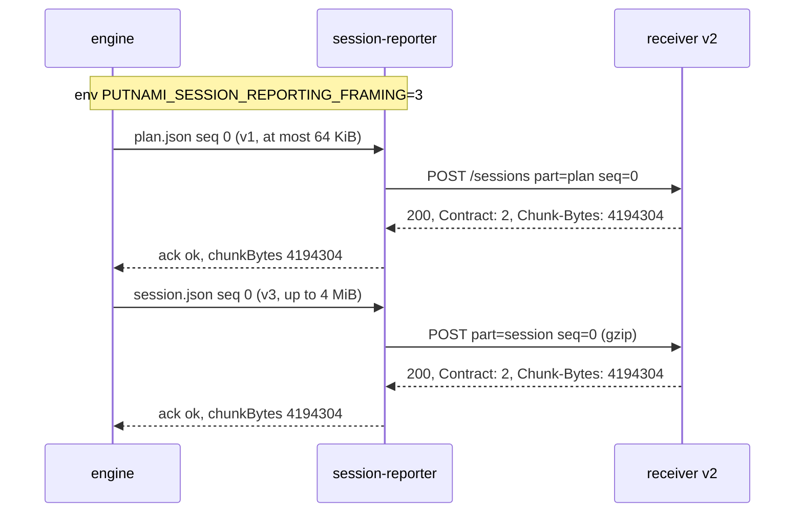

# ADR 0131 — A session reporter sends larger frames once its receiver advertises them

- **Status**: accepted
- **Date**: 2026-11-27
- **Amends**: [ADR 0033](0033-native-session-reporting.md), bounded
  transport; [ADR 0083](0083-the-session-reporter-uploads-a-trimmed-view-of-the-event-stream.md),
  the 64 KiB view frame; [ADR 0115](0115-a-local-run-hands-its-report-upload-to-a-detached-replay.md),
  the rejection of larger frames;
  [`cloud/extension` ADR 0001](../../../../cloud/extension/doc/adr/0001-a-reporter-compresses-a-chunk-once-the-receiver-advertises-gzip.md),
  "the number of requests does not change"
- **Scope**: `protocols/cli` (session reporting, its schema, its corpus and
  its TypeScript twin), `@putnami/cli` (`internal/sessionreporter`),
  `@putnami/cloud` (`internal/deliverycli`, the `session-reporter` command),
  and the Delivery session receiver of Putnami Cloud, specified here

## Context

A session's report travels three hops:



Every hop is strictly sequential: the engine sends a frame, the reporter posts
it, the receiver stores it, and only its answer lets the next frame leave. A
frame holds at most 64 KiB of decoded bytes (`SessionReportingChunkBytes`).
Since ADR 0001 the body is gzipped, which shrinks the bytes but not the count
of round trips.

Hosted runs and CI jobs drain before they exit (ADR 0115, decision 5). The
drain is what is left when the graph ends: `session.json`, which only exists
then, the events not yet sent, and `spec-verification.json`, each followed by
its empty final marker. Measured on Putnami CI: the gate ends 1 to
20 s after the session ends, about 12 s at the median on full `main` runs,
7 to 9 s on narrow pull request runs. A full run's `session.json` is 4.5 MB,
71 frames; its events are 32 MB in 510 frames. At about 140 ms per
acknowledged request (ADR 0115), 71 frames alone are about 10 s.

The cost is the count of sequential round trips. ADR 0115 rejected larger
frames and frames in flight as one-way doors of the receiver's sequence
contract. The owner settled on 2026-11-27 that the report delivery's design
is an implementation choice, and asked for a contract the current receiver
keeps working with.

## Decision

### 1. The receiver advertises larger frames; nothing changes until it does

A receiver that stores frames larger than 64 KiB says so on every answer of
its session routes, as it already says `Accept-Encoding: gzip`:

```
X-Putnami-Session-Contract: 2
X-Putnami-Session-Chunk-Bytes: 4194304
```

`X-Putnami-Session-Chunk-Bytes` is the largest **decoded** frame it stores,
between 65,537 and 4,194,304 (`SessionReportingMaxChunkBytes`, 4 MiB). A
header outside that range, or without the contract header, advertises
nothing. The reporter reads the headers on every answer: the latest answer of
a destination decides, as for gzip.

### 2. The engine learns the cap through the acknowledgements



- The engine sets `PUTNAMI_SESSION_REPORTING_FRAMING=3` in the session
  reporter's environment (`SessionReportingFramingEnv`). It says that this
  engine reads `chunkBytes` in acknowledgements and sends version 3 frames.
  It is not a credential. The log reporter does not get it.
- A reporter that reads it adds `chunkBytes` to every acknowledgement: the cap
  its destination's latest answer advertised, or 65,536. A reporter that does
  not read it, an earlier one, never sends the member, and an earlier engine,
  which never sets the variable, never receives it: its strict parser would
  refuse it.
- The engine cuts each new frame at the latest `chunkBytes`, at most 4 MiB.
  A frame of more than 64 KiB is a **version 3** frame
  (`SessionReportingLargeFrameVersion`), and only such a frame is: a frame of
  64 KiB or less keeps version 1 and its exact bytes. A version 3 frame's line
  is bounded by `SessionReportingMaxLineBytes` (6 MiB), its acknowledgement
  echoes version 3, and every other rule of version 1 holds: offset,
  sequence, SHA-256, a separate empty final marker, the plan and
  spec-verification bounds.
- The live rule of ADR 0033 reads "a full frame" as a frame at the current
  cap: an events chunk leaves when the cap's worth of bytes is ready or after
  the batch interval (10 s), so the receiver's writes stay bounded by run time
  over the interval.

### 3. Falling back is per frame and never changes a sequence's bytes

- The reporter posts a version 3 frame only when its destination's latest
  decisive answer advertised a cap at least as large. An answer is decisive
  unless it is a `5xx`, a `408` or a `429`, which a gateway in front of the
  receiver may give whether or not the receiver stored the frame. When the
  destination has not answered in this process, after a restart or in a
  replay, the reporter first sends one `OPTIONS` request to the same route,
  which stores nothing, and reads the headers of its answer, gzip's
  included.
- Otherwise it posts nothing and answers `ok: false`,
  `code: frame_unsupported`, without retry
  (`SessionReportingCodeFrameUnsupported`). A `413` answer to a version 3
  frame gets the same code: the receiver stored nothing. A frame that an
  earlier attempt in this process sent without a decisive answer never gets
  that code, because the receiver may hold it: it gets a retryable
  `receiver_unavailable`, and its sequence keeps its bytes.
- The engine answers `frame_unsupported` on a version 3 frame it cut in this
  process, on its first attempt, by dropping it, durably, and cutting the
  same offset and sequence again at 64 KiB. The receiver never stored that
  sequence, so the next frame is new to it. Later frames follow the next
  acknowledgement's `chunkBytes`. On a later attempt, or on a frame read back
  from a checkpoint, whose earlier attempt may have been stored, the code is
  a refusal like any other: delivery fails with the frame pending for a
  replay. Any other refusal keeps its ADR 0033 meaning.
- Fail closed: a `200` answer to a version 3 frame that does not advertise a
  cap at least as large is not durable acceptance of it (a receiver rolled
  back may have stored it truncated). The reporter answers
  `receiver_mismatch` without retry, as ADR 0001 does for gzip.
- A checkpoint's pending version 3 frame is resent as it is, with the same
  identity and bytes, so a receiver that stored it answers an identical
  replay.

The current receiver therefore sees exactly today's requests: it advertises
nothing, every acknowledgement says 65,536, and the engine never cuts a frame
above 64 KiB.

### 4. What the Delivery receiver must change

Putnami Cloud owns the receiver; this repository cannot change it. The
reporter works against it unchanged (section 3). To get the larger frames, it
changes as follows, on the hosted ingest route (`POST <ingest>/sessions`) and
the local-sessions route (`POST <workspace>/ci/local-sessions/<session>`):

1. **Advertise** `X-Putnami-Session-Contract: 2` and
   `X-Putnami-Session-Chunk-Bytes: <cap>` on every answer, refusals
   included, beside `Accept-Encoding: gzip`. The recommended cap is 4 MiB
   (4,194,304), the protocol's maximum; a smaller one is valid.
2. **Answer `OPTIONS`** on both routes with `204` and the same headers. It
   stores nothing and needs no body; answering it with or without the bearer
   is the receiver's choice, and the headers carry no secret.
3. **Accept a decoded frame up to the cap**: a raw body up to the cap, and a
   gzip body whose decoding stops at cap + 1 bytes (a decompression bound)
   and is refused with `413` past the cap. A frame of 64 KiB or less is
   unchanged.
4. **Keep the sequence contract**: one dense sequence per part, an identical
   replay answered `200 {"part","seq"}`, conflicting bytes `409`, a gap
   `409 {"expectedSeq"}`, the final marker a separate empty frame. Frames of
   one part may now differ in size (64 KiB, then up to the cap, then 64 KiB
   again after a fallback): a reader concatenates a part's frames by
   sequence and never derives an offset from `seq × 65536`.
5. **Store within the reporter's request timeout** (4 s) a frame at the cap.
6. **Advertise only once every instance behind the route accepts the cap.**
   A mixed fleet stays correct, at a cost: a version 3 frame whose first
   attempt reaches an instance without the change gets `413`, the engine cuts
   it again at 64 KiB, and the next advertising answer raises the cap again;
   on a later attempt it is retried as it is until it reaches an instance
   that takes it.
7. **Never lower the cap under a session that saw it.** A frame whose
   earlier attempt may have been stored is never cut again (section 3), so
   it is delivered only by a receiver that takes its size. A cap is a
   property of the deployment: a smaller one is advertised from the first
   answer of a session. A receiver rolled back below a cap it advertised, in
   the middle of a session, leaves that session undelivered, as a receiver
   rolled back from gzip does (ADR 0001).

The reporter and the receiver deploy in either order.

### 5. What is not done here, and why

- **Several frames in flight.** It would let frames of one part reach the
  receiver out of order, so the receiver's dense sequence (item 4) would
  become a window, and the engine's checkpoint would hold several pending
  frames instead of one. With 4 MiB frames, the measured drain of an
  unchanged run falls from 72.1 s to 1.4 s (Measurements): about ten
  sequential round trips, the eight events frames of the backlog and the
  final markers. A window of four would save at most about 0.8 s of it, for a
  second contract change, and most of that backlog is the `test:case`
  records replayed for cached tasks (16.6 of 26.5 MB on an unchanged run),
  which a later slice replaces with the cache key. Rejected for this slice
  on that measurement.
- **`session.json` sent during the run.** Frames carry a byte offset into an
  append-only artifact, and `session.json` is not one: the engine writes it
  whole, atomically, at the end, and its `endTime` and `run` members precede
  its task records, so no prefix of it is stable before the graph ends. With
  4 MiB frames, its 2.5 MB on the measured run leave in one frame and its
  final marker, and the 4.5 MB of a full CI run in two. The task records reach the receiver during the run in the next
  slice, as one package per task.
- **The final marker folded into the last data frame.** It would save one
  round trip per artifact, three in a drain, but it changes the frame's
  identity rule (a final frame is empty) that the engine's cursors, the
  view's end and every replay rely on. Left for the per-task packages, which
  define their own completion.

## Consequences

- With a receiver that advertises 4 MiB, an unchanged run of this
  repository sends 15 or 16 requests instead of 530, and its CI drain falls
  from 72 s to 1.5 s (Measurements). 4 MiB beats 1 MiB (4.1 s), so it is the
  recommended cap.
- With the current receiver, every request is the same as before, at no
  added cost: no probe is sent, because the reporter sends `OPTIONS` only
  for a version 3 frame, and the engine cuts none until an answer advertised
  a cap.
- A checkpoint may hold a pending frame of up to 4 MiB: `reporting.json`
  reads stop at 12 MiB (twice `SessionReportingMaxLineBytes`), and each such
  frame is written and synced once before it leaves. A CLI older than this
  one refuses a checkpoint whose pending frame is version 3; a downgrade with
  such a pending frame leaves that session undelivered.
- The log reporter keeps 64 KiB frames: its route is not this receiver's
  session route, and it refuses a version 3 frame with `invalid_chunk`.
- An `@putnami/cloud` reporter older than this change reads lines of at most
  96 KiB plus 128 KiB. A checkpoint whose pending frame is version 3, replayed
  through such a reporter, fails until a newer reporter runs; an older
  reporter never names a cap, so only a downgrade between the run and its
  replay meets this.
- The request timeouts are unchanged: 4 s for the reporter's request, 5 s for
  the engine's call. A 4 MiB frame of this repository's sessions compresses
  to about 200 KB, so it stays far inside them; an incompressible one needs
  about 9 Mbit/s of uplink to fit, and a receiver whose clients have less
  advertises a smaller cap from the start (section 4, item 7). A timeout is a retryable failure, so the frame is
  retried as it is.

### Measurements

Local receiver fixture (dense sequence per part, identical replay, `409` on
a gap or a conflict, gzip, a decoded cap with `413` past it, 140 ms per
answer, the median round trip ADR 0115 measured), a 4-core Linux container,
this change's CLI and reporter, `CI=1` so the run drains before it returns.
The command is `lint,test,build,validate --impacted --enforce-coverage` of
this repository, served from the cache: 2.5 MB of `session.json`, 27 MB of
`events.jsonl`. Drain is the time from the session's `endTime` to the
process exit. Without a reporter the same run takes 22.0 s.

| Receiver | Requests (events, plan, session, spec) | Body bytes | Drain | Wall |
|---|---|---|---|---|
| Version 1, today's (the fallback) | 530 (416, 27, 39, 48) | 2.17 MB | 72.2 s | 92.8 s |
| Version 2, 1 MiB | 39 (27, 4, 4, 4) | 1.94 MB | 4.4 s | 25.3 s |
| Version 2, 4 MiB | 16 (9, 3, 2, 2) | 1.92 MB | 1.9 s | 26.8 s |
| Version 2, 4 MiB, again | 15 (8, 3, 2, 2) | 1.92 MB | 1.5 s | 22.6 s |

The version 1 rows are this change against today's receiver: no request
carries a frame above 64 KiB and no `OPTIONS` is sent. A first version 1 run,
whose tasks still ran for 172 s, drained in 14.8 s: the live events had
left during the run, and the drain was `session.json`, the events of the
last ten seconds and `spec-verification.json`, as on Putnami CI.
