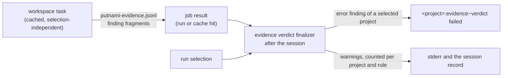

# ADR 0134 — A run fails on the findings of the projects it selected

- **Status**: accepted
- **Date**: 2026-11-27
- **Amended**: 2026-11-27. A workspace task keys on the projects the run
  selected unless its task declares `selection: none` (Context, items 1, 2 and
  6), and warnings print one line per project and rule (item 4)
- **Scope**: `@putnami/cli` (`internal/engine`, `internal/specgate`,
  `internal/jobs/cachekey`, `internal/jobs/remotecache`,
  `internal/jobs/scheduler`), `protocols/evidence` (the evidence fragment,
  kind `finding`), `protocols/extension` and `protocols/cli` (the task member
  `selection` and contract 31)
- **Implements**: part of ADR 0006 of `protocols/evidence` (evidence is
  fragments that tasks emit and a collector streams): the `finding` fragment
  and a first, local verdict over fragments

## Context

A check whose read set is the workspace, such as the feature validation of
`@putnami/sdd`, runs today as one task per project. Each of the 123 copies
reads nearly the same files, and each re-runs on every commit. One workspace
task would do the work once, but a narrowed run must still report, and fail
on, the findings of the projects it selected only.

A verdict must not depend on the selection, or a cached one would be
replayed for another selection. A project task keys the same under every
selection, but a task that runs once for the workspace is handed the projects
the run selected, and its key holds them (`doc/10-caching.md`): each selection
gets its own entry, whether the task reads the selection or not.

The spec gate already decides after the session from what tasks wrote, read
from the session or, on a narrowed run, from the cache (ADRs 0026 and 0072).

## Decision

1. **A task states findings; it does not decide.** A task writes its findings
   as `finding` fragments (`protocols/evidence`) in `putnami-evidence.jsonl`,
   which it declares as a required file of its command output and writes on
   every run, empty when it finds nothing. Their paths are relative to the
   task's project. A task that only reports findings succeeds whatever they
   say. The planner lets one task per project and command declare the file. A
   workspace task that reads no selection declares `selection: none` (item 6).
2. **The declaration decides what is read.** Every execution and every
   restore replaces a required command-output file whole, so the verdict reads
   the same file whether the task ran or was served from the cache, and never
   an earlier run's. For a task that declares `selection: none`, one entry
   serves every selection. `putnami-evidence`
   names the file as an artifact: a cache hit restores it on the result, as for
   the verification report and the criteria projection, so reports list it.
3. **The CLI decides after the session.** A finalizer reads the fragment file
   of every task that declares it and succeeded, run or restored. It stamps
   each finding with the project whose directory is the longest prefix of its
   path; a declared root project owns what no other project does. It
   fails the run once per selected project that has an error finding, as a
   synthetic `<project>:evidence~verdict` result that lists those findings as
   diagnostics.
4. **The selection decides what fails.** An unscoped run counts every
   project. A narrowed run counts the projects it selected, and findings that
   no project owns, which belong to no selection and so count under every
   one. The warnings of the counted projects change no exit code. They print
   on stderr as one line per project and rule, with its count, sorted, and
   each reaches the session record as one `evidence:warning` session event in
   `events.jsonl`: its project, the task that stated it, its rule, message and
   place. A session event is no task, so a warning neither counts nor votes,
   and a warm run records it without executing anything.
5. **A file the reader refuses fails the task that wrote it**, as
   `<project>:evidence~verdict`, naming the file, under every selection. So
   does a declared file that is missing, one declared optional, and the
   artifact reported by a task that does not declare the file. Silence is no
   verdict. The diagnostics carry the producers' rule names as codes, which
   are not codes of the CLI.
6. **A task that reads no selection says so.** A task declares
   `selection: none` (`protocols/extension`, contract 31 of `protocols/cli`)
   when what it does is the same whichever projects the run selected. The CLI
   then hands it no `selection` and no `selectedProjects` in its job context,
   so no `PUTNAMI_SELECTED_*` variable and no selection template variable,
   and keys it on no selected project. The task cannot read what its key
   omits, and one entry serves `--all`, `--impacted` and `--projects`. A task
   that does not declare it keeps its key on the projects the run selected.

## Rejected alternatives

- **The selection as a keyed runtime input of the task.** Sound, but each
  selection would get its own entry, and the primitive would retire with the
  verdict of ADR 0006. A workspace task that does not declare
  `selection: none` is keyed this way.
- **A key without the selected projects for every workspace task.** A task
  that reads `selectedProjects` would be replayed for another selection.
- **Every warning on its own stderr line.** An unscoped run of this
  repository printed 2,574 lines.
- **A succeeded synthetic row that lists the warnings.** It would count as a
  task that ran, on every run that has a warning, warm runs included.
- **An uncached workspace task that reads the selection.** It would run on
  every run, unchanged runs included.
- **A cached workspace task that fails on any project's finding.** A narrowed
  run would fail on projects it did not select.

## Consequences

- A workspace check can replace its per-project copies without changing what
  a narrowed run reports. `@putnami/sdd`'s feature validation is the first.
- The finalizer is a first piece of the local verdict of ADR 0006. When that
  verdict lands, it reads the same fragments and replaces this finalizer.
- The CLI binds to `protocols/evidence`, and to `protocols/codehost` through
  it, as it binds its other indirect protocol dependencies. Only
  `internal/specgate` imports the evidence protocol. The
  jobs packages keep the reserved file name and artifact id as literals, so
  their import allowances do not grow; a test pins them to the protocol.
- A finding whose path no project owns, in a workspace without a root
  project, fails every run that sees it. A producer that wants a narrower
  reach names a path inside a project.
