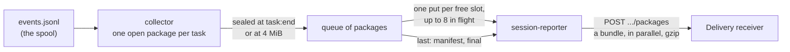

# ADR 0135 — A run delivers its report as task packages sent in parallel

- **Status**: accepted
- **Date**: 2026-11-27
- **Amends**: [ADR 0131](0131-a-session-reporter-sends-larger-frames-once-its-receiver-advertises-them.md),
  which stays the fallback for a receiver that advertises no packages
- **Scope**: `protocols/cli` (session reporting), `@putnami/cli`
  (`internal/sessionreporter`), `@putnami/cloud` (`internal/deliverycli`),
  and the Delivery session receiver of Putnami Cloud, specified here

## Context

Even with larger frames (ADR 0131), a session's report travels as one byte
stream per artifact, each frame acknowledged before the next leaves. The
owner decided on 2026-11-27 that a run submits its data to an in-process
queue, that a collector packages, batches and sends it in chunks that travel
in parallel while the run goes on, that nothing in the run waits on the
sending, and that nothing is dropped: the full history of every task stays.

## Decision

### 1. A package is a task's records, addressed by their content

- The collector reads `events.jsonl`, the session's spool, as a subscriber
  (ADR 0033), and keeps one open package per task identity key. Every record
  goes, byte for byte, to the package of its `identity.key`; a record without
  one, such as `session:end`, goes to the run's package, key `""`.
- A package is sealed at its task's `task:end`, when one more record would
  take it past 4 MiB, or when the stream is final. A later record of the same
  key opens a new package. Sealing depends only on the stream's bytes, never
  on time, so a replay seals the same packages.
- A package's bytes are one header line, then its records as persisted. The
  header names the package format, its kind (`task`), its key, its part
  number and the raw offset of each record in `events.jsonl`, so a receiver
  can rebuild the stream byte for byte. The address is the SHA-256 of the
  package's bytes. `session.json` and `spec-verification.json` travel as
  packages of kind `session` and `spec-verification`, cut in parts of at most
  4 MiB, numbered from 0, which the receiver concatenates in order. A
  session.json of any size is delivered; spec-verification.json keeps its
  8 MiB bound (ADR 0033).
- Nothing is trimmed: the trimmed view of ADR 0083 applies to frames only.

### 2. Packages travel in parallel; the manifest closes the session

- The engine batches: whenever one of its 8 slots is free, it sends every
  package sealed since, as one `put` line whose bundle (section 4) stays
  within 8 MiB, to the session
  reporter, which answers it with a `put` result of the same address (the
  SHA-256 of its packages' addresses). Results arrive in any order. A put
  that fails with retry is sent again, at most 3 times. A put's deadline
  grows with the size of its decoded bundle: 5 s plus 2 s per MiB in the
  engine, 4 s plus 2 s per MiB for the reporter's request, so the reporter
  answers first. Eight puts sharing an uplink fit from about 4 Mbit/s when
  gzip shrinks the records about seven times, as it does this repository's,
  and from about 27 Mbit/s uncompressed. A put past its deadline is a failure
  in transport: the reporter is started again and every put in flight is
  sent again, as it was. The count of requests therefore follows the round
  trips, not the tasks: a run that ends a thousand tasks at once sends them
  in a few puts.
- Once every package of the stream and every document is acknowledged, the
  engine sends one `manifest` line, final, listing every address in sealing
  order, then the documents. Its acknowledgement completes the delivery.
- The checkpoint records the acknowledged addresses. A replay rebuilds the
  same packages from the spool and sends only those not acknowledged; a
  receiver answers a package it holds as accepted.
- The subscription acknowledges the raw offset before the first record of a
  package that is open or not acknowledged, so evidence never overstates
  delivery.
- Nothing in the run waits: the collector reads committed bytes like any
  subscriber, and the graph's end waits only for what is still in flight.

### 3. Negotiation keeps every older party working

- The engine names framing version 4 in the session reporter's environment
  (`PUTNAMI_SESSION_REPORTING_FRAMING=4`). A reporter of ADR 0131 reads it as
  at least 3 and behaves as there.
- A reporter that speaks packages, whose destination's latest decisive answer
  carried `X-Putnami-Session-Packages: 1`, adds `packages: true` to each
  frame acknowledgement. The engine starts as in ADR 0131 with `plan.json`
  frames; it switches to packages at the first acknowledgement that says
  `packages: true`, provided no `events.jsonl` or `session.json` frame left
  yet, and stays on frames for the session otherwise.
- A reporter or a receiver that never says so keeps the session on frames:
  today's receiver gets today's requests, and one of ADR 0131 its larger
  frames.

### 4. What the Delivery receiver must change

On the hosted ingest route and on the local-sessions route of a session:

1. Advertise `X-Putnami-Session-Packages: 1` on every answer once it stores
   packages, beside the headers of ADR 0131, whose
   `X-Putnami-Session-Contract: 2` stays as it is: a reporter of ADR 0131
   reads only that value.
2. `POST <route>/packages`, body a bundle, gzip-encoded when it advertised
   gzip: for each package, one line `{"kind":...,"address":...,"length":N}`
   then its N bytes. Store each package whose decoded bytes' SHA-256 is its
   address; answer `200` once every package of the bundle is stored, new or
   identical, `400` for a wrong digest or a malformed bundle, `413` past
   8 MiB decoded (the engine keeps every bundle, its lines included, within
   it). Bundles of one session may arrive in any order and
   concurrently, and may repeat a package.
3. `POST <route>/manifest`, JSON `{"addresses": [...], "final": true}`:
   answer `200` once every listed package is stored, `409` with
   `{"missing": [...]}` otherwise. A final manifest completes the session.
4. Derive a session's events by concatenating, per raw offset, the records
   its packages hold, and a document by concatenating its parts.

## Consequences

- The report leaves during the run, the packages of finished tasks batched
  into at most eight puts in flight; what remains when the graph ends is the last tasks' packages, the
  documents and the manifest. Measured drains are in the pull request of this
  change.
- A receiver gets every record, debug lines of passing tasks included; gzip
  keeps the bytes small (ADR 0001).
- A session whose first acknowledgement does not offer packages stays on
  frames: plan.json, frames, then the drain of ADR 0131.
- Cached tasks still send their replayed records; the next slice replaces
  them with their cache key.
