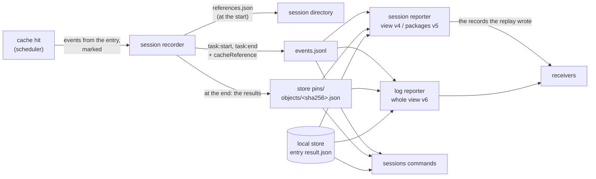

# ADR 0137 — A cached task is recorded by its cache entry, not by its replayed records

- **Status**: accepted
- **Date**: 2026-11-27
- **Amends**: [ADR 0083](0083-the-session-reporter-uploads-a-trimmed-view-of-the-event-stream.md),
  which the session reporter now cuts from the resolved stream;
  [ADR 0135](0135-a-run-delivers-its-report-as-task-packages-sent-in-parallel.md),
  whose task packages carry the rebuilt records to a receiver that reads
  them; [ADR 0033](0033-native-session-reporting.md), whose log reporter
  receives a session recorded by reference resolved;
  [ADR 0111](0111-the-cli-collects-garbage-at-200-percent.md), whose
  collection keeps the results a retained session references
- **Scope**: `protocols/cli` (the session stream, the reporting
  acknowledgement, their schemas, corpus and TypeScript twin, and the task
  package header), `@putnami/cli-model` (`jobs`), `@putnami/cli`
  (`internal/jobs/scheduler`, `internal/output`, `internal/machine`,
  `internal/store`, `internal/sessionrefs`, `internal/sessionreporter`,
  `internal/commands/sessions`, `internal/engine`), `@putnami/cloud-extension`
  (`internal/deliverycli`)

## Context

A cache entry holds the events a task's execution emitted that a report
needs (`store.EntryResult.Events`) and its result data, test cases included.
A hit replays them: the scheduler hands every one to the renderers, and the
session recorder writes each as a `task:event` record, then one `test:case`
record per case, into `events.jsonl`. An unchanged run therefore rewrites,
for every task it reuses, records the session directory of the run that
filled the entry already holds, and pays to sanitize, encode and append each
of them on the task's path. On this repository's unchanged
`lint,test,build,validate` over 1,724 tasks, 1,674 of them local hits, the
session's `events.jsonl` is 24.4 MB: 31,221 `test:case` records (16.7 MB) and
5,244 `task:event` records (5.2 MB), nearly all replayed (measurements in the
pull request).

The owner decided on 2026-11-27 that a cached task reports its cache key, not
its events, that the local session record references the cache too, and that
nothing is dropped: every reader keeps the full history, by reference.

## Decision



### 1. A reused task's `task:end` names the entry that holds its records

A task whose result a task-owned entry of the local store served (a local
hit, a remote hit the provider published into it, a coalesced restore) is
recorded as `task:start`, the records the hit added this run (a recovered
artifact, a drift diagnostic, a result event rebuilt for an entry that holds
none), and its `task:end`, which carries:

```json
"cacheReference": {"entry": "sha256:…", "result": "sha256:…", "events": 3, "testCases": 412, "projection": 1, "records": "sha256:…"}
```

`entry` is the key the store files the entry under (the task's
`inputDigest`, bound to the project's source for a source-bound task),
`result` the SHA-256 of the entry's `result.json`, `events` how many of the
entry's events the hit replayed and `testCases` how many `test:case` records
its result data yields. `projection` is the version of the function that
rebuilds those records from the entry and the `task:end`
(`output.CachedRecords`), and `records` the SHA-256 of the records it
rebuilt when the recorder wrote the reference, each followed by LF. The
stream holds none of those records: a reader rebuilds them, right before the
`task:end`, and verifies the result digest, both counts and the records
digest. The member is permitted on a `task:end` whose task was reused and
not skipped, and is the last member of the record.

The rebuilt records are the same records the recorder writes for the task
recorded whole, not the same stream: the records the hit added this run come
before them, where a task recorded whole has them after the entry's events.

### 2. A session records by reference where every reader resolves it

A run records by reference when it records its session through a renderer
other than the machine renderer, uses a cache, verifies no cache in another
store, and is neither a bound portable execution nor a run one of its tasks
started. It declares it first, before any reporter opens its checkpoint, in
`references.json` beside `events.jsonl`, which names the absolute root of the
store its references resolve in; readers resolve in that store, and fall back
to the store of the workspace whose `.putnami/sessions` holds the session. A
session that cannot write the file records whole.

Otherwise the run writes every record, as before: `--output=jsonl` keeps its
artifact complete for `putnami cloud ci report`, which folds it; a runner
bundle travels to a machine whose store does not hold the entries, and so do
the sessions of the CLIs its tasks start, which the bundle carries too; a
cache-verification store is not the one readers open. A bound portable run's
scheduler exports `PUTNAMI_RECORD_SESSIONS_WHOLE=1` into every task
subprocess, like `PUTNAMI_PARENT_SESSION`: execution-only, never in the
job context, which is hashed, and re-asserted after the task's own
environment, so a task cannot blank it. A CLI that finds it records whole and
exports it to its own tasks.

### 3. Every reader of a recorded session resolves the reference

- The `sessions` commands read `events.jsonl` through one reader, which
  yields the rebuilt records, then the `task:end` without its reference.
- The session reporter's view (ADR 0083) puts the rebuilt records and the
  `task:end` without its reference in place of the record.
- A session on task packages (ADR 0135) puts the same rebuilt records in the
  reused task's package, right before its `task:end`, which it holds without
  its reference. The package header names their indexes in an optional
  `rebuilt` member, and gives each the raw offset of that `task:end`, so a
  package's offsets never decrease and two are equal only after a rebuilt
  record. The receiver places the rebuilt records before the `task:end` at
  that offset. Sealing is a function of the stream, the entries and the
  projection, so a replay with the same projection seals the same packages,
  at the same addresses.
- The log reporter frames, for such a session, a view that trims nothing and
  only puts the referenced records back, at the offsets of those bytes: its
  receiver gets every record, as from a session recorded whole.
- Spec verification, `report.json` and the renderers read the run's results
  in memory, which are unchanged.

A reporter's checkpoint takes its version from `references.json`, and every
older version reads as it did:

| version | capability | frames |
|---:|---|---|
| 1 | log reporter, or a session reporter checkpoint that framed raw | raw bytes |
| 2 | session reporter | the trimmed view |
| 3 | session reporter | packages |
| 4 | session reporter, session by reference | the trimmed view, references put back |
| 5 | session reporter, session by reference | packages, references put back |
| 6 | log reporter, session by reference | the whole view, references put back |

A new checkpoint of a session by reference is version 4 or 6. Version 4
moves to 5 only on an acknowledgement that offers packages and
`packagesRebuilt` (section 5); version 2 moves to 3 on `packages` alone. A
version 1 checkpoint that framed nothing yet moves to the version a new one
takes; one that already framed raw bytes of a session by reference is
refused rather than sent raw, since raw framing would deliver every reused
task without its records. A CLI that predates references refuses versions
4, 5 and 6, so it never resumes such a delivery. It may still open a new
checkpoint for a reporter the recording run never opened, and frame the
session raw: replay a session by reference with this CLI or a later one.

### 4. A reference this CLI cannot rebuild is named, never rebuilt to other bytes

The rebuilt bytes depend on the reader's code, not only on the stream and the
entry: the sanitizer, the test-case bounds, the record shapes. A reader whose
`output.CachedRecordsProjection` is not the reference's `projection`, whose
verified result yields other record counts than the reference names, or
whose rebuilt records do not hash to `records`, rebuilds nothing. The result
it read is the producer's, byte for byte, so the difference is the reader's
code:

- the view and the packages stop delivery with `reporting cannot rebuild a
  reused task's records`, which names the projection; no byte of the task
  leaves, the checkpoint keeps its pending frame, and a CLI of the recording
  projection delivers the session from there;
- `sessions inspect` shows the `task:end` as recorded, `cacheReference`
  included, and notes that the task is not resolvable by this CLI, in text
  and in its data (`unresolvedReferences.notResolvableByThisCli`).

A golden test pins the bytes and the digest projection 1 rebuilds for a
plain entry, two events and three cases below every bound and with nothing
to redact. It does not cover every input: a change to a test-case bound or
to a sanitizer pattern leaves it as it is, and only the records digest
catches it, when a reader rebuilds a reference recorded before the change.

### 5. Rebuilt records in packages need an engine and a receiver that read them

A receiver that parses packages under ADR 0135 alone refuses equal offsets,
and an engine of ADR 0135 refuses an acknowledgement member it does not
know. Each side therefore says that it reads them:

- this engine names framing version 5 in
  `PUTNAMI_SESSION_REPORTING_FRAMING` (`SessionReportingRebuiltPackagesVersion`):
  everything version 4 says, and that it reads `packagesRebuilt` in
  acknowledgements;
- a receiver that stores packages whose header names rebuilt records keeps
  `X-Putnami-Session-Packages: 1` and adds
  `X-Putnami-Session-Packages-Rebuilt: 1` on its decisive answers, so a
  reporter that predates this change still gets packages from it;
- a reporter adds `packagesRebuilt: true`, which only an acknowledgement with
  `packages: true` may carry, for an engine that named version 5 or later,
  once the receiver's latest decisive answer carried both headers. An engine
  of version 4 gets `packages` alone, as before.

A session by reference whose acknowledgements offer packages without
`packagesRebuilt` stays on frames at version 4. No deployment order is
needed: until the engine, the reporter and the receiver all read rebuilt
records, such a session stays on frames, and a session that holds every
record goes on packages as before.

### 6. A reference whose result is gone reads as recorded, on every surface

A reference whose result neither a pin nor the entry holds (after
`putnami cache clean`, or a session whose pin was lost) rebuilds nothing, and
every surface reads its `task:end` as recorded, `cacheReference` included:
the `sessions` commands, the view, the whole view and the packages. A
receiver, or a reader, sees which task's records are missing, rather than a
reused task that emitted nothing. `sessions inspect` counts them too
(`unresolvedReferences.unavailable`). A replay whose earlier attempt resolved
the reference refuses its pending frame as a changed artifact, as for any
stream that changed, or seals a package at an address the receiver does not
hold.

### 7. Retention keeps the results a retained session references

A reader of a reference opens only the entry's `result.json`. When the
session ends, the recorder hands the store every result the stream
references, and the store keeps each once, by its digest, at
`pins/objects/<sha256>.json`: a hard link to the entry's `result.json`, or a
copy where the file system links nothing, kept only when its bytes hash to
the digest the reference names. It then writes one pin,
`pins/<digest of the session directory>.json` (version 2), naming the session
directory and those digests. Readers read the kept result first, then the
entry, and verify the digest either way. The entries themselves, outputs
included, stay under ordinary collection, by budget and by idleness.

Every collection pass (ADR 0111) deletes the pins whose session directory no
longer exists and the version 1 pins of earlier builds of this change, which
named entries, then the kept results no pin names. It looks first without a
lock, and takes the store's exclusive lock only when it has one to delete;
the recorder keeps results under the shared lock, so a pass never deletes a
result being pinned. A pin of a later version keeps every result: it may
name any. So pruning sessions (`sessions.keep`) releases their results.
`putnami cache clean` removes them whatever pins them (section 6). A session
that never ends (a killed process) writes no pin: its results are those of
the entries the run just used, which collection keeps as long as it keeps
recent entries.

A pin names its session by absolute path: a session directory moved, or
reached through another path by a store shared with a container or another
worktree, loses its pin at the next pass. A CLI that predates pins ignores
`pins/`: its collection neither keeps nor deletes the kept results, and the
entries it evicts no longer take a referenced result with them.

## Rejected alternatives

- **Compress or trim the replayed records.** gzip shrinks that
  `events.jsonl` 20.9 times for 0.2 s of CPU, but the hits keep sanitizing,
  encoding and appending its 36,465 `test:case` and `task:event` records on
  the task's path: their restore and replay take 0.69 s of the run, 0.30 s by
  reference.
- **Send references to the receiver.** The receiver is outside this
  repository, and a hit served from an entry the remote cache does not hold
  (a read-only credential keeps local fills local) has nothing for it to
  resolve. The reporters resolve locally; a receiver that resolves by key,
  with a client that sends the entries it lacks, is a later step.
- **Resolve under the subscription, for every subscriber.** Every offset a
  subscriber acknowledges and `subscribers.json` records would become an
  offset of a stream no file holds. The views already map raw offsets to
  their own.
- **Pin the entries.** A pin of whole entries keeps their outputs out of
  budget collection for files no reader opens: on one developer's store
  after a day on this change, 16 pins named 3,419 entries holding 1.37 GB of
  unique bytes, of which the `result.json` files a reader opens were
  45.5 MB.
- **Record the log reporter's sessions whole.** The policy is fixed when the
  run records, but a replay selects its reporters later: a session recorded
  by reference and replayed with a log reporter would reach it raw.
- **A side file listing the referenced tasks.** `events.jsonl` would no longer
  say which tasks it holds whole; a reader without the side file would read
  a cached task as one that emitted nothing.

## Consequences

- An unchanged run writes its tasks' `task:start` and `task:end`, not their
  replayed records: on the run above, `events.jsonl` goes from 24.4 MB
  (session `20261128-002639-4f44f7`, before this change) to 4.5 MB (session
  `20261128-002547-9b4310`), and to 4.2 MB once rebased on task packages
  (session `20261128-024530-603db3`); the session directory goes from
  30.5 MB to 11.2 MB.
- The store keeps, per referenced result, a hard link that costs no byte
  while its entry stands and the size of its `result.json` once collection
  evicted the entry, and one pin per retained session of about 67 bytes per
  result it references (measurements in the pull request). No entry outlives
  its ordinary collection for a session's sake.
- A CLI that predates this change refuses to resume a version 4, 5 or 6
  checkpoint, so the detached replay of an owed session by reference fails
  under an older `./putnamiw` (another worktree on `main`, during rollout).
- A reader of `events.jsonl` that does not know `cacheReference` reads a
  cached task as `task:start` and `task:end` only, and the recorded
  `session:end` counts in `machineOutput` only the records the stream holds.
